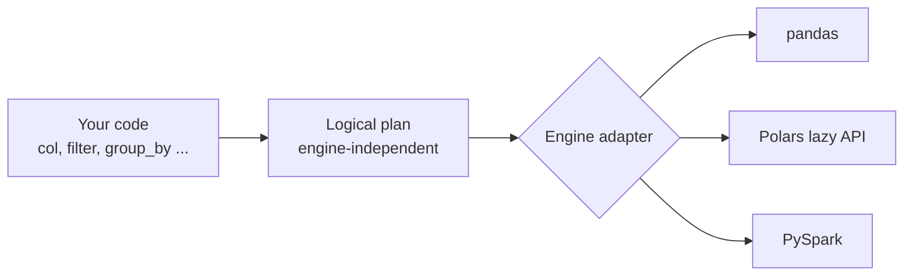

# Frameflow

Frameflow is a backend-agnostic dataframe execution framework.

The goal is to allow users to write dataframe code once and execute it on
multiple engines such as:

- Pandas
- Polars
- Spark

Frameflow uses an adapter architecture to abstract execution engines.

Status: Early development. Only the pandas engine works today, and the API below is the target, not what is implemented yet (expressions such as `col(...)` arrive in Phase 1). See the [Development Plan](#development-plan).

---

## Target API

```python
from frameflow import Session, col

session = Session(engine="polars")  # or "pandas", "spark"

result = (
    session.read_csv("sales.csv")
    .filter(col("amount") > 100)
    .group_by("product")
    .agg(total=col("amount").sum())
    .sort("total", descending=True)
    .collect()
)

result.to_pandas()  # or .to_polars(), .to_dicts()
```

Changing `engine` is the only change needed to run the same pipeline on another engine.

---

## How It Works

Frameflow separates **describing** a pipeline from **running** it:



1. **Expressions** (`col("amount") > 100`) are Frameflow objects, never engine objects, so user code can't depend on one engine.
2. **Operations** (`filter`, `group_by`, `join`, ...) don't run straight away. They add a step to a **logical plan**.
3. **`collect()`** (or a write) hands the plan to the selected **engine adapter**, which translates it into that engine's native, ideally lazy, API and runs it.

This keeps adapters small (they translate a plan, rather than implementing dozens of methods) and lets Polars and Spark optimise the whole query.

---

## Development Plan

### Phase 0: Foundations
- [x] Project structure, `uv` and `pytest` setup
- [x] Base `EngineAdapter` contract (`adapters/base.py`)
- [x] `Session` entry point and engine selector
- [x] Pandas adapter (eager)
- [x] `FrameflowDataFrame` wrapper, so engine dataframes don't leak to users
- [x] One public API style: method chaining on `FrameflowDataFrame`; `Session` only reads data and selects the engine
- [x] Exception types in `exceptions.py` (`UnsupportedEngineError`, `UnsupportedOperationError`, ...)
- [x] Optional extras: `frameflow[polars]`, `frameflow[spark]`, `frameflow[parquet]`, `frameflow[excel]`
- [x] CI with GitHub Actions: `ruff`, `mypy`, `pytest` on every pull request

### Phase 1: Expressions and logical plan (on pandas)
- [ ] Expression API in `api/column.py`: `col`, `lit`, comparisons, arithmetic, `&` / `|` / `~`, `is_null`, `alias`
- [ ] Aggregations: `sum`, `mean`, `min`, `max`, `count`
- [ ] Logical plan nodes in `core/contracts.py`: read, select, filter, with_columns, group_by + agg, join, union, sort, limit
- [ ] Plan execution in `core/dispatcher.py`, with adapters looked up through `core/registry.py`
- [ ] Pandas adapter rewritten to execute plans
- [ ] **Engine conformance test suite**: the same tests, inputs and expected results run against every engine

### Phase 2: Polars engine
- [ ] Polars adapter that translates plans into Polars' lazy API
- [ ] Conformance suite passing on Polars

### Phase 3: Spark engine
- [ ] Spark adapter that translates plans into PySpark DataFrames
- [ ] Conformance suite passing on a local Spark session in CI

### Phase 4: Breadth and correctness
- [ ] More operations: `rename`, `drop`, `distinct`, `when` / `otherwise`, string and date functions
- [ ] Schema and dtype API
- [ ] Defined, tested behaviour where engines differ: nulls, null join keys, integer division, sort stability
- [ ] `collect()` returns a result with `.to_pandas()`, `.to_polars()` and `.to_dicts()`
- [ ] Clear `UnsupportedOperationError` when an engine can't run an operation

### Phase 5: Release 0.1.0
- [ ] Documentation with examples for each engine
- [ ] Engine support matrix (which operations each engine supports)
- [ ] Changelog and semantic versioning
- [ ] Publish to PyPI

---

## Design Principles

- **No engine leaks.** Users never receive or pass pandas, Polars or Spark objects unless they ask for one explicitly (`to_pandas()`, ...).
- **Same input, same output.** An operation is only supported on an engine once the conformance suite proves it gives the same result as the others.
- **Lazy by default.** Nothing runs until `collect()` or a write, so engines can optimise the whole pipeline.
- **Small core, optional engines.** Installing Frameflow doesn't pull in Polars or Spark; each engine is an optional extra.
- **A focused API.** Around 20 operations that cover real pipelines, rather than mirroring all of pandas.

### Related projects

[Narwhals](https://github.com/narwhals-dev/narwhals) and [Ibis](https://ibis-project.org/) also offer one dataframe API across several engines. Frameflow focuses on data-engineering pipelines: reading from and writing to data lakes, with Spark as a first-class engine.

---

## Current API (pandas)

```python
from frameflow import Session

session = Session(engine="pandas")

top = (
    session.read_csv("sales.csv")
    .filter(lambda df: df["amount"] > 100)  # engine-specific until Phase 1
    .select(["product", "amount"])
    .sort("amount", descending=True)
)
top.write_parquet("top_sales.parquet")  # needs frameflow[parquet]

totals = top.group_by("product").agg({"amount": "sum"}).collect()  # list of dicts
```

`Session` only reads data and picks the engine; every other operation is a method on the returned dataframe.

Optional extras:

| Extra     | Installs   | Needed for                        |
|-----------|------------|-----------------------------------|
| `parquet` | `pyarrow`  | `read_parquet`, `write_parquet`   |
| `excel`   | `openpyxl` | `read_excel`, `write_excel`       |
| `polars`  | `polars`   | the Polars engine (Phase 2)       |
| `spark`   | `pyspark`  | the Spark engine (Phase 3)        |
| `all`     | all of the above |                             |

If an extra is missing, Frameflow raises `MissingDependencyError` with the `pip install` command to fix it.

---

## Development

Requires Python 3.10+ and [uv](https://docs.astral.sh/uv/).

```bash
uv sync                  # install dependencies, including dev tools
uv run pytest            # tests
uv run ruff check        # lint
uv run ruff format       # format
uv run mypy              # type check
```

CI runs the same checks on every pull request and push to `main`, with tests on Python 3.10 to 3.13.
